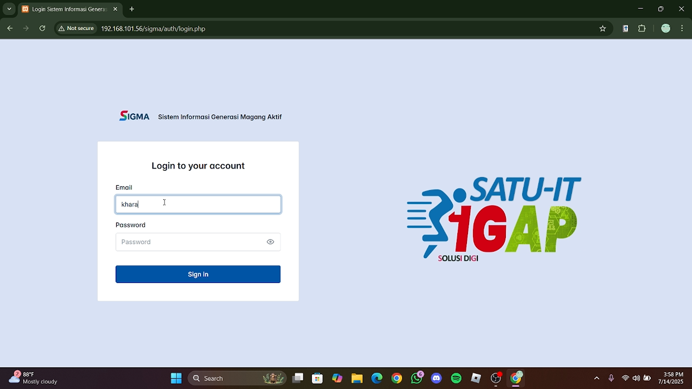
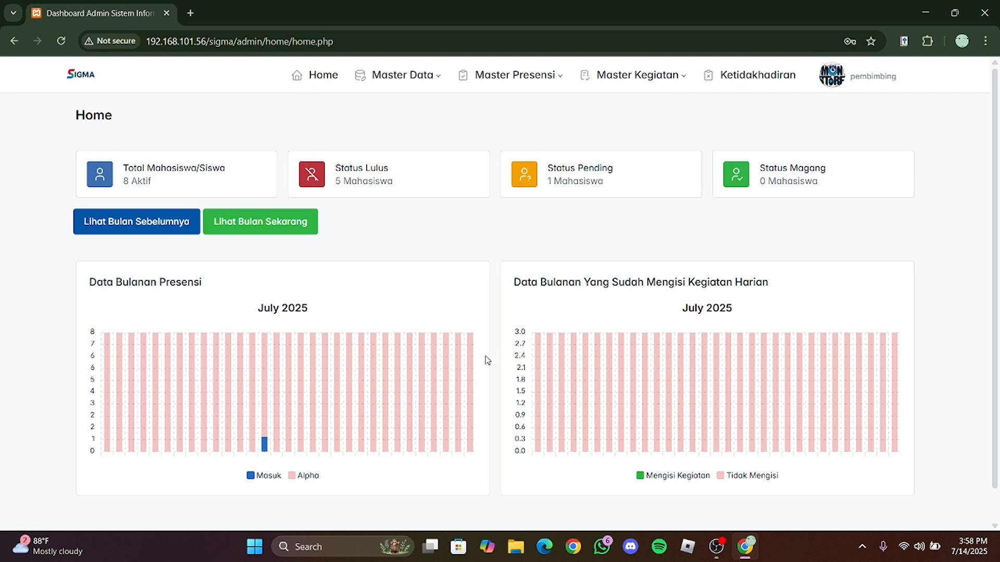
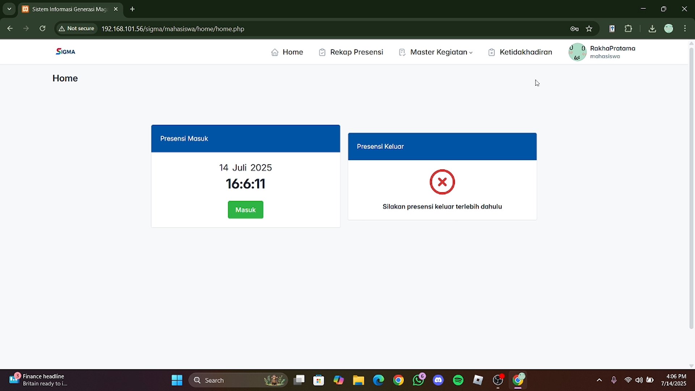
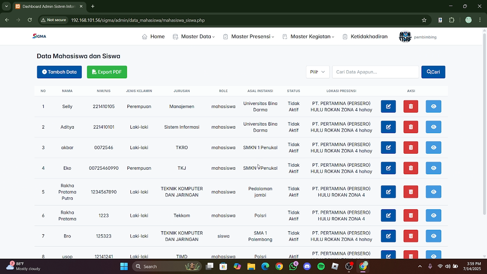
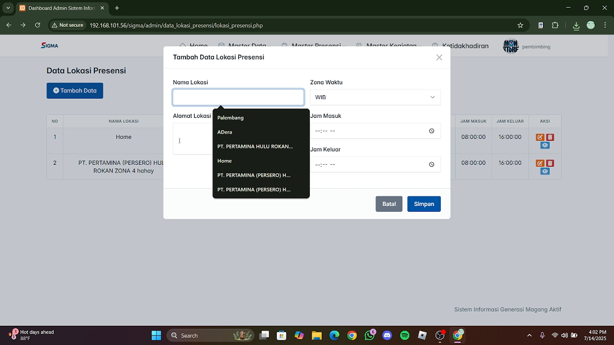
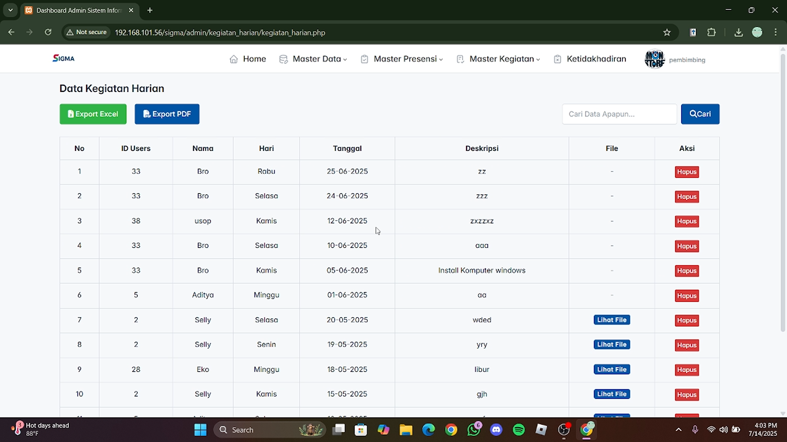
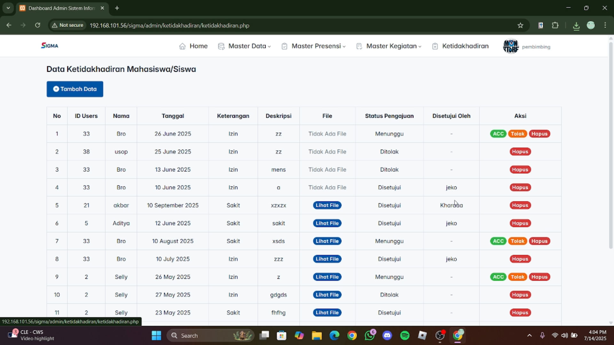
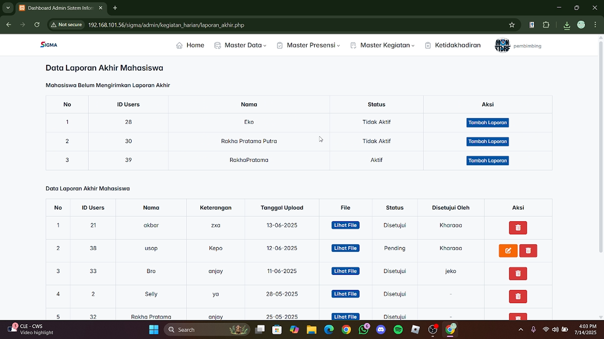
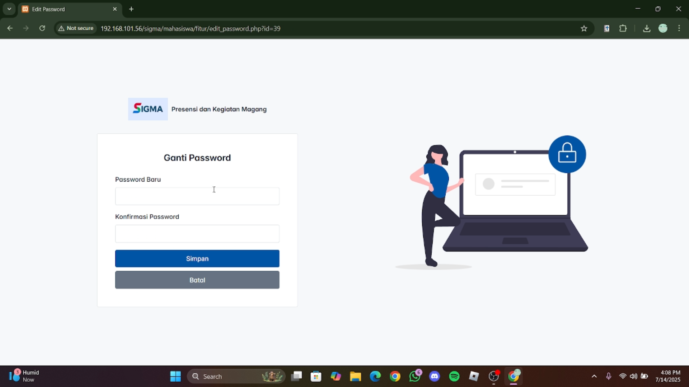

# SIGMA (Sistem Informasi Presensi dan Monitoring Magang)

SIGMA adalah aplikasi web yang dikembangkan untuk membantu instansi **PT Pertamina Hulu Rokan Zona 4 Prabumulih** dalam mengelola presensi dan aktivitas peserta magang/PKL secara digital.

## Fitur

### Untuk Mahasiswa/Siswa Magang
- **Presensi Masuk & Keluar** - Melakukan presensi berdasarkan lokasi
- **Kegiatan Harian** - Mengisi laporan kegiatan harian selama magang
- **Pengajuan Izin** - Mengajukan izin dengan alasan dan bukti pendukung
- **Laporan Akhir** - Mengunggah laporan akhir magang
- **Riwayat Presensi** - Melihat rekap kehadiran pribadi
- **Profil & Ganti Password** - Pengaturan akun pribadi

### Untuk Admin/Pembimbing
- **Dashboard Statistik** - Monitoring kehadiran, kegiatan, izin, dan laporan peserta magang
- **Manajemen Data Peserta Magang** - Tambah, edit, hapus data peserta magang
- **Manajemen Data Pegawai** - Mengelola data pembimbing/admin
- **Manajemen Lokasi Presensi** - Mengatur lokasi presensi yang valid
- **Verifikasi Pengajuan Izin** - Menyetujui/menolak pengajuan ketidakhadiran
- **Verifikasi Laporan Akhir** - Memverifikasi laporan/project akhir peserta magang
- **Rekap Presensi** - Rekap presensi harian & bulanan
- **Export Data** - Mengekspor data ke format **PDF** dan **Excel**

## Teknologi yang Digunakan

- **Backend:** PHP Native
- **Database:** MySQL
- **Frontend:** HTML5, CSS3, JavaScript
- **Framework CSS:** [Tabler](https://tabler.io/)
- **Library:** jQuery
- **Export:** Dompdf, PhpSpreadsheet

## Tampilan Aplikasi

### Halaman Umum & Autentikasi
| Halaman | Preview |
| --- | --- |
| Login |  |

### Dashboard
| Halaman | Preview |
| --- | --- |
| Dashboard Admin |  |
| Dashboard Mahasiswa/Magang (Presensi Masuk/Keluar) |  |

### Manajemen Data (Admin)
| Halaman | Preview |
| --- | --- |
| Data Peserta Magang |  |
| Form Tambah Data Peserta Magang |  |
| Data Lokasi Presensi |  |
| Form Tambah Data Lokasi Presensi |  |

### Presensi, Kegiatan & Izin
| Halaman | Preview |
| --- | --- |
| Data Kegiatan Harian Peserta Magang |  |
| Data Pengajuan Ketidakhadiran (Izin) |  |
| Tambah Data Ketidakhadiran dari Admin |  |
| Tambah Pengajuan Ketidakhadiran dari Peserta Magang |  |

### Laporan Akhir & Rekap
| Halaman | Preview |
| --- | --- |
| Data Laporan/Project Akhir Peserta Magang |  |
| Upload Laporan/Project Akhir dari Admin |  |
| Upload Laporan/Project Akhir dari Peserta Magang |  |
| Rekap Presensi Harian |  |
| Rekap Presensi Bulanan |  |
| Ekspor Data Peserta Magang |  |

### Lainnya
| Halaman | Preview |
| --- | --- |
| Profil Peserta Magang |  |
| Ganti Password Akun |  |

## Cara Instalasi (Localhost)

1. **Clone repository**
   ```bash
   git clone https://github.com/username-kamu/SIGMA.git
   cd SIGMA
   ```

2. **Pindahkan ke htdocs**
   - Pindahkan folder project ke `C:\xampp\htdocs\` (XAMPP) atau `C:\laragon\www\` (Laragon)

3. **Buat database**
   - Buka `phpMyAdmin` → Buat database baru dengan nama `sigma_db`
   - Import file `sigma_db.sql` yang ada di root project

4. **Konfigurasi**
   - Salin `config.example.php` menjadi `config.php`
   - Sesuaikan konfigurasi database di `config.php` jika diperlukan

5. **Jalankan aplikasi**
   - Akses melalui browser: `http://localhost/SIGMA/`
   - Aplikasi akan langsung mengarah ke halaman login

## Demo

- **Live Demo:** *(Segera hadir - akan diupdate setelah hosting)*
- **Source Code:** [GitHub Repository](https://github.com/Rakhalord18/SIGMA)

## Kontributor

- **Rakha Pratama Putra** - [LinkedIn](https://linkedin.com/in/rakha-pratama-putra) | [GitHub](https://github.com/rakhalord18)

## Catatan

Project ini dibuat sebagai bagian dari kegiatan magang di **PT Pertamina Hulu Rokan Zona 4 Prabumulih** pada tahun 2025.
